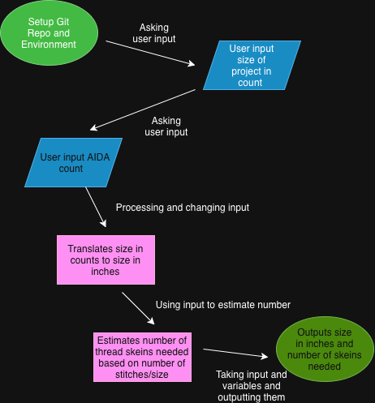

# CrossStitchCalculator

Java project that takes user input and statistics to predict size, number of thread skiens needed, cost, and time
estimated for a cross stitch project.

## The Problem

I have made numerous cross stitch projects, and I did not begin the design far enough from the edge of the fabric; 
therefore, it was very difficult to frame it properly. I would like to calculate the data for size, thread count, and 
time prior to beginning the process, so I am more prepared.

## How It Works

This project is a Java program that uses methods to ask for user input. The program will output the correct 
measurements, count, and results based on what the user wants.


## Tech Stack

- **Language:** Java
- **Libraries:** N/A
- **External tools:** IntelliJ IDEA

## Setup

- Clone the repository

```bash
git clone https://github.com/YOUR-USERNAME/CrossStitchCalculator.git
```
- Open IntelliJ IDEA and choose File > Open, then select the cloned CrossStitchCalculator folder.
- Wait for IntelliJ to finish indexing the project.
- There are no extra libraries, tools, or installs needed.

## Usage

- In the Project panel, open src/Main.java.
- Click the green Run arrow next to main.
- The program will begin by asking you for input in the Run console at the bottom of the window. 
- Type your answer and press Enter for each prompt. Example of the run console listed below.

```bash
Enter the design width in stitches: 120
Enter the design height in stitches: 150
Enter the AIDA fabric count (e.g. 14): 14
...
Finished size: 8.6 in x 10.7 in
Skiens needed: 6
Estimated cost: $4.50
```

## Roadmap

Features you haven't built yet but plan to (pull these from your
"Schedule" quadrant in the Eisenhower Matrix).

- [ ] Estimated Time for Completion based on my previous project data read from a seperate file
- [ ] Adding different numbers of thread for stitches, and implementing the variable into the formulas
- [ ] Able to run program multiple times for different patterns

## Author

Katie Stephenson, https://github.com/kstep03


