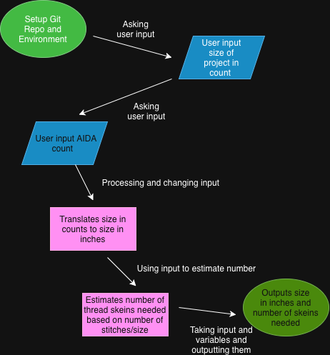

# CrossStitchCalculator

Java project that takes user input and statistics to predict size, number of thread skiens needed, cost, and time
estimated for a cross stitch project.

## The Problem

I have made numerous cross stitch projects, and I did not begin the design far enough from the edge of the fabric; 
therefore, it was very difficult to frame it properly. I would like to calculate the data for size, thread count, and 
time prior to beginning the process, so I am more prepared.

## How It Works

This project is a Java program that uses methods to ask for user input. The program will output the correct 
measurements, count, and results based on what the user wants.


## Tech Stack

- **Language:** Java
- **Libraries:** N/A
- **External tools:** IntelliJ IDEA

## Setup

- Clone the repository

```bash
git clone https://github.com/YOUR-USERNAME/CrossStitchCalculator.git
```
- Open IntelliJ IDEA and choose File > Open, then select the cloned CrossStitchCalculator folder.
- Wait for IntelliJ to finish indexing the project.
- There are no extra libraries, tools, or installs needed.

## Usage

- In the Project panel, open src/Main.java.
- Click the green Run arrow next to Main.
- The program will begin by asking you for input in the Run console at the bottom of the window. 
- Type your answer and press Enter for each prompt. Example of the run console listed below.

```bash
Enter width of project (in counts): 20
Enter height of project (in counts): 39
Enter AIDA count of fabric (e.g. 14): 49
Do you have a specific price of thread that you want to input? (type yes if so) no
Do you want to change the buffer variable from 5 inches/side (type yes if so) no
...
Finished project size: 0.41 x 0.80 inches
Size of fabric needed: 10.41 x 10.80 inches
Skeins of thread needed: 1
Total estimated cost: $15.84
Estimated time to complete: 0.21 hours (based on 4 past project(s))
```

## Roadmap

Features you haven't built yet but plan to (pull these from your
"Schedule" quadrant in the Eisenhower Matrix).

- [X] Estimated Time for Completion based on my previous project data read from a seperate file
- [ ] Adding different numbers of thread for stitches, and implementing the variable into the formulas
- [X] Able to run program multiple times for different patterns
- [X] Option to ouput a completed project to data.txt to be analyzed for total estimated time for future projects.

## Author

Katie Stephenson, https://github.com/kstep03


